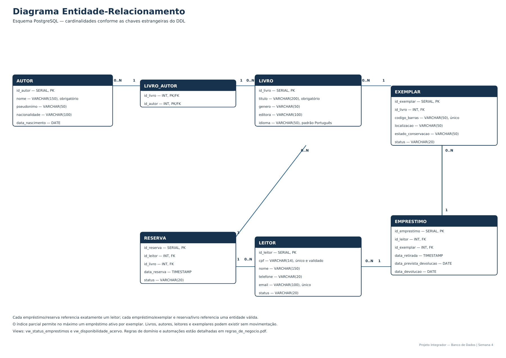

# Entrega da 2ª Semana
## Modelagem conceitual e modelo relacional

### 1. Objetivo da etapa

Representar os dados e relacionamentos da biblioteca por meio do DER e definir um modelo relacional que reduza redundâncias e sustente as operações previstas.

### 2. Entidades e responsabilidades

| Relação | Chave primária | Responsabilidade |
|---|---|---|
| `AUTOR` | `id_autor` | Identificar autores e seus dados biográficos. |
| `LIVRO` | `id_livro` | Manter os dados bibliográficos das obras. |
| `LIVRO_AUTOR` | `id_livro`, `id_autor` | Associar livros e autores em uma relação muitos-para-muitos. |
| `LEITOR` | `id_leitor` | Manter identificação, contato e situação cadastral dos leitores. |
| `EXEMPLAR` | `id_exemplar` | Representar cada unidade física do acervo. |
| `EMPRESTIMO` | `id_emprestimo` | Registrar a retirada e a devolução de exemplares. |
| `RESERVA` | `id_reserva` | Registrar solicitações de reserva feitas por leitores. |

O detalhamento dos atributos, tipos, nulabilidade e restrições está no [dicionário de dados](../../documentacao/dicionario_de_dados.pdf). O esquema implementado está representado no [DER atualizado](../../documentacao/der.pdf).

### 3. Relacionamentos e cardinalidades

| Relacionamento | Cardinalidade | Interpretação |
|---|---|---|
| `AUTOR` — `LIVRO`, por `LIVRO_AUTOR` | N:N | Um autor pode estar associado a zero ou vários livros; um livro pode estar associado a zero ou vários autores. Cada linha associativa referencia exatamente um autor e um livro. |
| `LIVRO` — `EXEMPLAR` | 1:N | Um livro pode ter zero ou vários exemplares; cada exemplar pertence a exatamente um livro. |
| `LEITOR` — `EMPRESTIMO` | 1:N | Um leitor pode ter zero ou vários empréstimos históricos; cada empréstimo pertence a exatamente um leitor. |
| `EXEMPLAR` — `EMPRESTIMO` | 1:N | Um exemplar pode ter zero ou vários empréstimos históricos; cada empréstimo referencia exatamente um exemplar. No máximo um empréstimo por exemplar pode estar ativo. |
| `LEITOR` — `RESERVA` | 1:N | Um leitor pode ter zero ou várias reservas; cada reserva pertence a exatamente um leitor. |
| `LIVRO` — `RESERVA` | 1:N | Um livro pode ter zero ou várias reservas; cada reserva referencia exatamente um livro. |

As cardinalidades refletem as chaves estrangeiras do esquema atual. A ausência de uma restrição de mínimo permite cadastrar livros ainda sem exemplares ou leitores ainda sem movimentação.

### 4. Modelo relacional

O modelo separa dados de referência e de circulação. As tabelas `AUTOR`, `LIVRO` e `LEITOR` armazenam cadastros; `EXEMPLAR` representa a cópia física; `EMPRESTIMO` e `RESERVA` registram eventos; `LIVRO_AUTOR` resolve a relação N:N.

As chaves estrangeiras preservam os vínculos entre as relações. A chave primária composta de `LIVRO_AUTOR` impede repetir o mesmo vínculo entre livro e autor.

### 5. Decisões de normalização

- **Primeira Forma Normal (1FN):** cada campo armazena um valor atômico; exemplares e autores não são mantidos como listas dentro do registro do livro.
- **Segunda Forma Normal (2FN):** na tabela associativa, os atributos dependem da chave composta completa; a relação mantém somente as chaves estrangeiras.
- **Terceira Forma Normal (3FN):** dados biográficos, bibliográficos e de circulação ficam em relações próprias, evitando dependências transitivas e repetição de dados cadastrais.
- **Dados derivados:** a situação temporal do empréstimo e a disponibilidade são calculadas por views; o estado do exemplar é sincronizado por gatilhos.

### 6. Resultado da etapa

O DER e o modelo relacional definiram sete relações e seus vínculos. O modelo foi refinado para corresponder às restrições efetivamente implementadas, e os documentos técnicos atualizados estão disponíveis em `documentacao/`.
