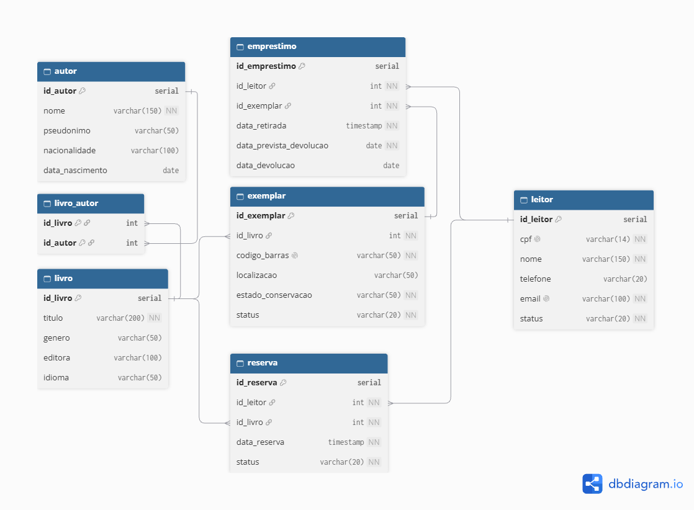
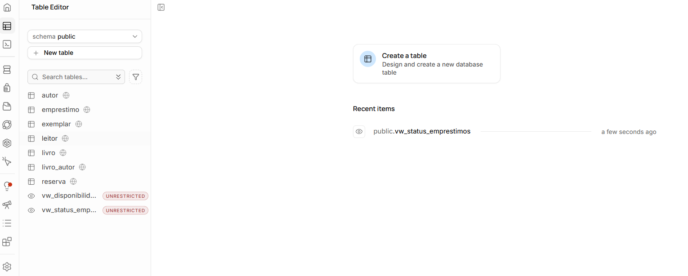
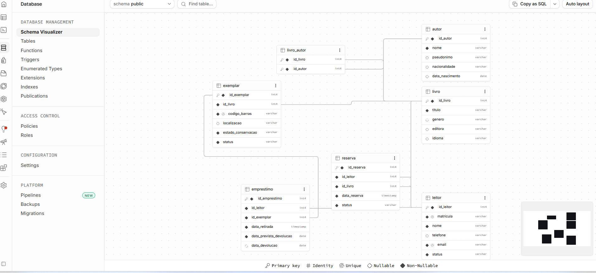
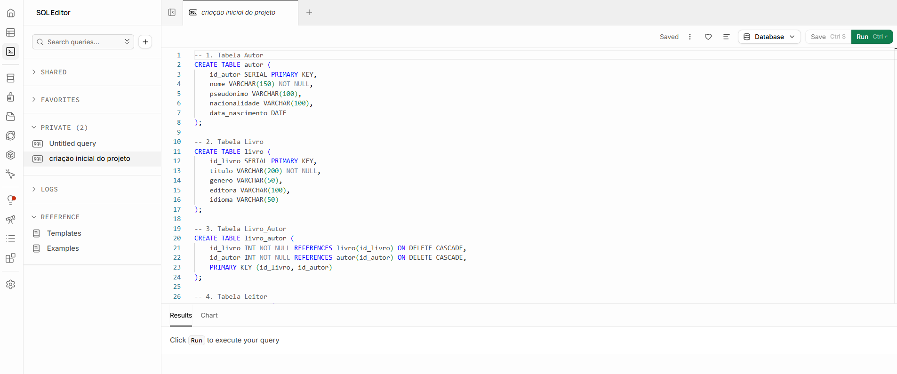
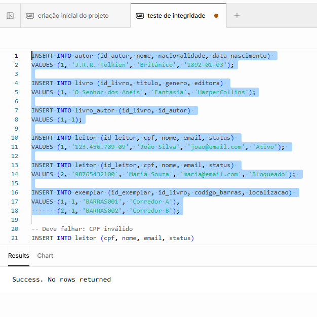
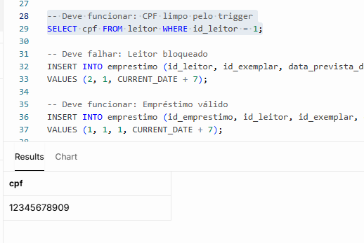
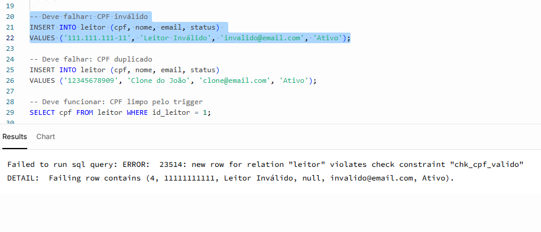
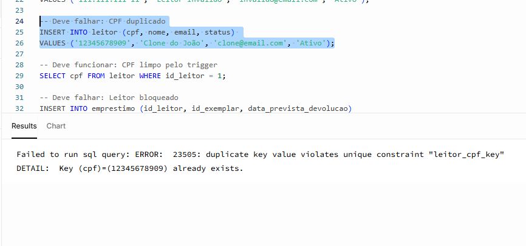
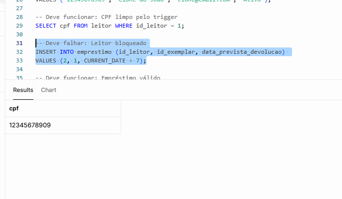

# Entrega da 3ª Semana
## Implementação física e validação inicial

### 1. Objetivo da etapa

Implementar o modelo relacional em PostgreSQL, estabelecer restrições de integridade e registrar evidências da estrutura e dos testes iniciais.

### 2. Estrutura implementada

O script `sql/01_criacao.sql` cria sete tabelas: `autor`, `livro`, `livro_autor`, `leitor`, `exemplar`, `emprestimo` e `reserva`. Também define chaves primárias e estrangeiras, índices, duas views e as funções e gatilhos necessários às regras do sistema.

| Recurso | Aplicação |
|---|---|
| Chaves e restrições | PK, FK, `UNIQUE`, `CHECK` e nulabilidade controlam identidade, vínculos e domínios. |
| Validação de CPF | Um gatilho normaliza a pontuação e uma função valida os dígitos verificadores. |
| Empréstimos | Restrições de datas, prazo máximo de sete dias, limite de três empréstimos ativos por leitor, bloqueio por atraso e exigência de exemplar disponível. |
| Reservas | O status é limitado aos valores permitidos; uma reserva pendente exige ausência de exemplar disponível. |
| Sincronização | Gatilhos atualizam a disponibilidade do exemplar na retirada e na devolução. |
| Views | `vw_status_emprestimos` calcula a situação temporal; `vw_disponibilidade_acervo` resume exemplares disponíveis e emprestados. |

### 3. Integridade e decisões físicas

As chaves estrangeiras evitam referências a leitores, livros ou exemplares inexistentes. Restrições únicas impedem duplicar CPF, e-mail e código de barras. Um índice parcial limita a um empréstimo ativo por exemplar. As operações de exclusão seguem as regras de dependência declaradas pelas FKs.

As views evitam armazenar estados derivados de datas. Os gatilhos mantêm o status físico do exemplar coerente com a movimentação registrada.

### 4. Validação e evidências

O material original da terceira semana continha capturas da interface de administração, do editor SQL e de resultados de testes. As imagens abaixo foram preservadas como registro histórico da versão demonstrada naquela etapa; elas não substituem a execução e validação dos scripts atuais.

### 5. Resultado da etapa

A etapa resultou na implementação física do esquema, com estruturas de integridade e automação. O script atual de criação é a referência para a definição vigente; a população, as consultas e os testes transacionais foram completados na quarta semana.

### Apêndice — capturas históricas

